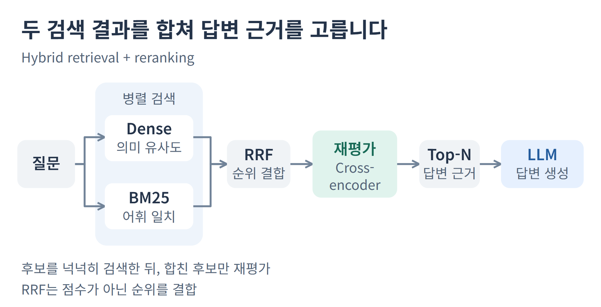

# 블로그 다이어그램 첫 시안

RAG의 병렬 검색과 합류 관계를 유지한 검토용 시안입니다. 기존 도식과 공통 CSS를 변경하지 않습니다. 사용자 판단 전 머지, 운영 배포, 전체 도식 적용은 진행하지 않습니다.

- [PNG 원본](hybrid-rerank.png)
- [글꼴 내장 SVG](hybrid-rerank.svg)
- [데스크톱 1280px 캡처](viewport-1280.png)
- [모바일 360px 캡처](viewport-360.png)

7개 노드와 7개 방향 관계를 유지했습니다. 데스크톱과 모바일은 동일 PNG를 비율 축소하며, 확인한 뷰포트에서 가로 넘침은 없습니다. 360px에서는 주요 라벨이 약 8.2px로 작아져 세부 읽기에 확대가 필요합니다.

PNG는 625px SVG 캔버스를 1920px 너비로 렌더했습니다. 이는 독립 시안 검증이며 블로그 production build나 전체 release 검증 결과는 아닙니다. SVG에 포함된 Noto Sans KR의 OFL 라이선스는 [FONT-LICENSE.txt](FONT-LICENSE.txt)에 있습니다.
